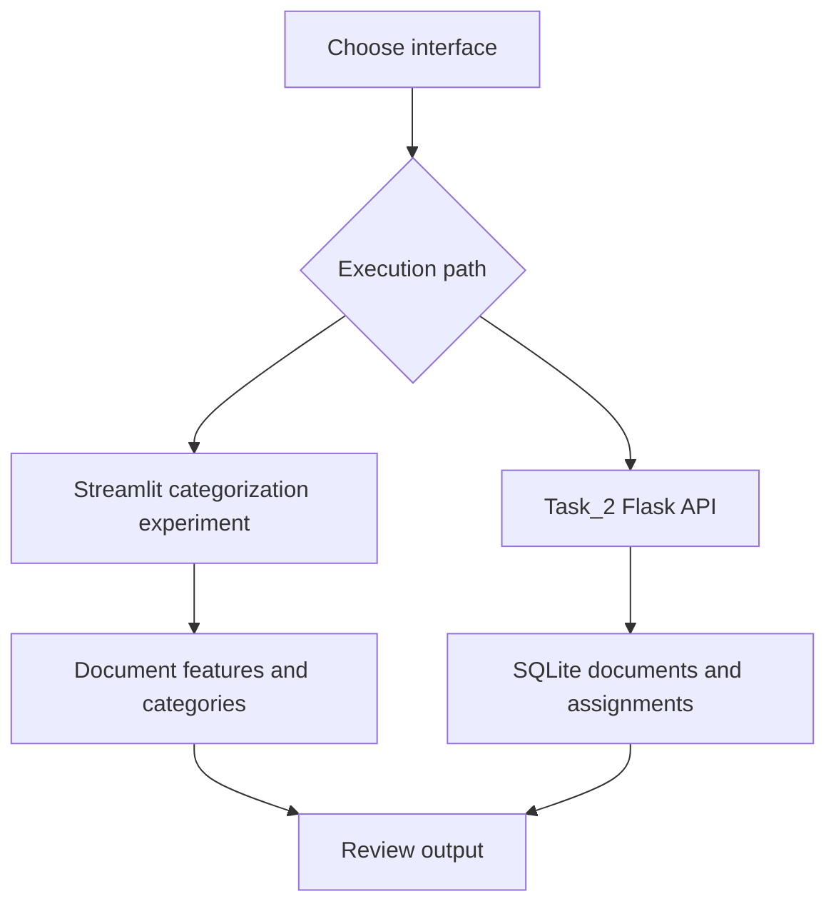

# Document Categorization and Cluster Management

Document categorization experiments with a Streamlit interface and a Flask SQLite cluster-management API.

## Project focus

Application / engineering project. The sections below separate the runnable entry point, source layout, prerequisites, and verification path.

## Architecture



## Repository structure

| Path | Purpose |
| --- | --- |
| [`LICENSE`](LICENSE) | Repository licensing terms. |
| [`Task_2/`](Task_2) | Project-specific source, resources, or learning material. |
| [`requirements.txt`](requirements.txt) | Python dependency manifest. |
| [`streamlit_app.py`](streamlit_app.py) | Python application helper or learning example. |
| [`tests/`](tests) | Automated checks and regression cases. |
| [`text_classifier.db`](text_classifier.db) | Dataset, fixture, state, or database file; inspect its schema before use. |

## Getting started

```bash
git clone https://github.com/Raimal-Raja/Document_Clustering_FlaskRestFul_API.git
cd Document_Clustering_FlaskRestFul_API
```

```bash
python -m venv .venv
source .venv/bin/activate
```

On Windows PowerShell, activate the environment with `.venv\Scripts\Activate.ps1` instead.

```bash
python -m pip install -r requirements.txt
```

```bash
python -m streamlit run streamlit_app.py
```

The separate Flask API can be launched from its application directory:

```bash
cd Task_2
python app.py
```

## Verification

```bash
python -m unittest discover -s tests -v
```

Install the selected project dependencies and optional test prerequisites first. Some integration checks require model artifacts, databases, or external services.

## Contributing

Include reproduction steps, the affected path, expected behavior, and the checks you ran. Keep credentials, generated environments, and unnecessary build artifacts out of commits.

## License

See [LICENSE](LICENSE) for the repository's license.
